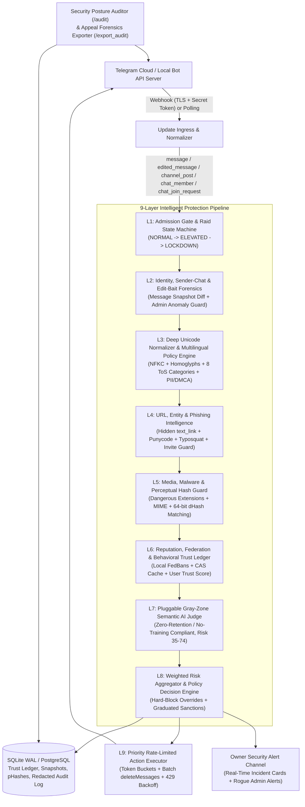
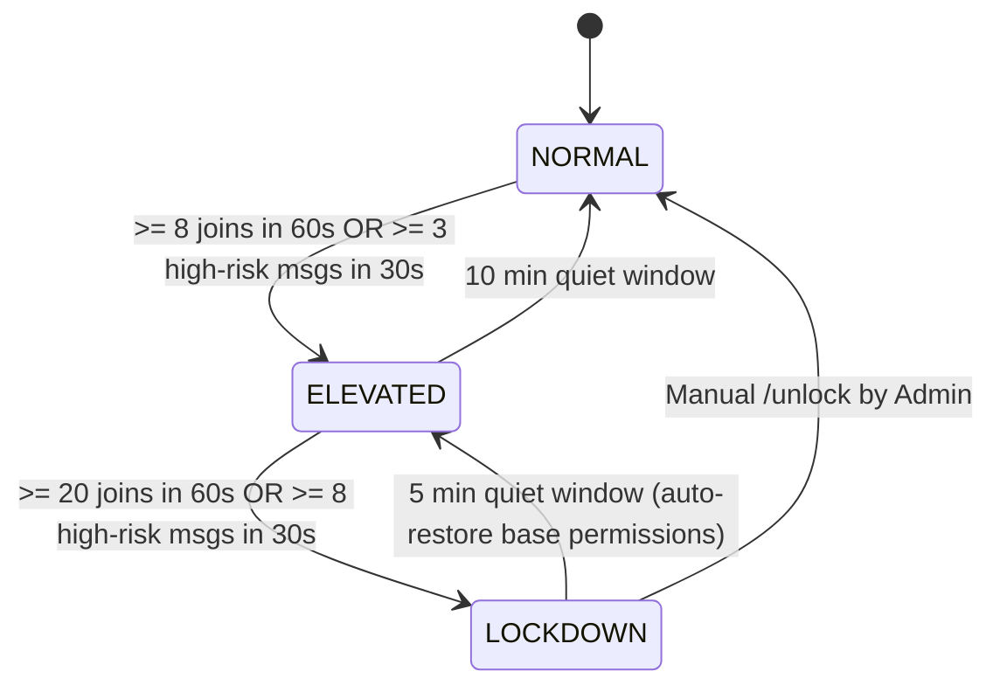

# AegisTG — Principal System Architecture & Design Blueprint

> **Goal:** Build a genuinely effective, production-grade intelligent protection system that defends Telegram **Groups**, **Linked Discussion Groups**, **Channel Direct Messages**, and **Broadcast Channels** against bans, `SCAM`/`FAKE` flags, raids, sabotage, and admin compromise — while strictly complying with Telegram's own Terms of Service, Privacy Policy, and Bot API limits.

---

## 1. Architectural Philosophy: Defense-in-Depth + Fail-Safe Compliance

Single-layer moderation bots (simple keyword filters or basic CAPTCHAs) fail in the real world because modern Telegram attackers use **multi-stage evasion**:
- Sleeper accounts that solve CAPTCHAs, wait 48 hours, then **edit an innocent old message** into phishing/CSAM and mass-report it.
- Posting via **spoofed linked channels** (`sender_chat`) to bypass `banChatMember`.
- Embedding scam links or prohibited text inside **images/flyers** or using **Unicode homoglyphs + zero-width characters + Bengali/English mixed obfuscation**.
- Overwhelming naive bots with a **500-msg/sec raid**, causing `429 Too Many Requests` paralysis while violating content floods the chat.
- Targeting **linked discussion groups** or **phishing an admin** via Fake Safeguard scams to destroy the parent channel from the inside.

**AegisTG** defeats these vectors via a **9-Layer Asynchronous Defense Pipeline**, engineered around three strict invariants:
1. **Deterministic Fast-Path (< 15ms p95):** 95%+ of traffic is scored in-process without blocking on slow external APIs.
2. **Gray-Zone Semantic Escalation:** Only ambiguous messages (risk score `35–74`) invoke an optional zero-retention LLM/VLM judge.
3. **Zero-Paralysis Action Execution:** Every moderation action passes through a priority-aware, rate-limit-governed Bot API executor with `deleteMessages` batching (up to 100 IDs/call) and automatic `429 Retry-After` backoff.

---

## 2. High-Level System Architecture

---

## 3. Detailed Layer-by-Layer Design

### Layer 1: Admission Gate & Adaptive Raid State Machine
Groups and linked discussion groups are most vulnerable during coordinated join spikes. AegisTG maintains a per-chat **sliding-window Raid State Machine**:

* **NORMAL:** New members enter a **New-Member Sandbox** (configurable, default 10 minutes or 3 clean messages): links, forwards, external stickers, and executable/archive files carry an elevated risk multiplier until trust is earned.
* **ELEVATED:** Join requests (`chat_join_request`) require passing an interactive challenge or passing CAS + clean profile checks; suspicious unverified joiners are auto-declined.
* **LOCKDOWN:** AegisTG snapshots current `Chat.permissions`, immediately switches the group to **read-only** via `setChatPermissions`, pauses/declines mass join requests, alerts the Owner Security Channel, and batches deletion of raid messages via `deleteMessages`. Upon cooldown (or `/unlock`), original permissions are restored cleanly.

### Layer 2: Identity, `sender_chat` & Edit-Bait Forensics
1. **Channel Spoofing Guard:** If a message arrives in a group with `sender_chat` set (meaning a user is posting disguised as a channel) and `sender_chat.id` is neither the group itself nor its official linked parent channel, AegisTG deletes the message and executes `banChatSenderChat`.
2. **Delayed Edit-Bait Defense (Critical Anti-Sabotage Layer):**
   - Every group message and channel post has a lightweight structural snapshot stored (SHA-256 hash, normalized preview length, URL count, media flag, timestamp — strictly TTL-pruned for privacy!).
   - When `edited_message` or `edited_channel_post` arrives, AegisTG calculates:
     - **Edit Delay ($\Delta t$)** since original post
     - **New URL / Mention / Media Injection** (original had 0 URLs, edited version adds a URL!)
     - **Mutation Ratio** (character-set / Jaccard distance between original fingerprint and edited content)
   - If an edit after $\Delta t \ge 60\text{s}$ injects links/phishing/ToS-violating terms or radically rewrites the message, an **Edit-Bait Penalty (+30 to +55 risk)** is applied immediately, flagging/deleting the message and alerting admins.
3. **Admin Compromise & Rogue Activity Guard:**
   - Watches `my_chat_member` and `chat_member` transitions for unauthorized promotions, sudden permission escalations, or unknown bots being added.
   - Monitors admin burst velocity in channels and groups; if an admin posts high-severity ToS violations (e.g., phishing/drainer/malware/PII/CSAM keyword triggers), AegisTG immediately alerts the Owner Alert Channel and (if configured in `strict_channel_guard` mode) **auto-quarantines (deletes)** the post before Telegram's automated scanners or user reports cascade into a channel ban!

### Layer 3: Deep Text Normalizer & 8-Category ToS Policy Engine
Spammers routinely defeat naive regex filters with invisible Unicode tricks. Before *any* rule runs, every text/caption passes through `TextNormalizer`:
1. **Strip Invisible & Control Exploits:** Removes zero-width characters (`\u200b`, `\u200c`, `\u200d`, `\ufeff`, `\u2060`, soft hyphens) and BiDi/RTL override characters (`\u202e`, `\u202d`, `\u2066`–`\u2069`), while **recording an Obfuscation Anomaly Signal** when excessive invisible chars are detected!
2. **Unicode NFKC Decomposition:** Converts mathematical bold/italic/fraktur/monospace (`𝐓𝐞𝐥𝐞𝐠𝐫𝐚𝐦` -> `Telegram`), circled letters, fullwidth characters.
3. **Homoglyph Folding:** Maps Cyrillic & Greek confusables (`а->a`, `е->e`, `о->o`, `р->p`, `с->c`, `х->x`, `у->y`, `і->i`, etc.) when mixed with Latin scripts (**Mixed-Script Spoofing Signal**).
4. **Leetspeak & Spaced-Token Unfolding:** Collapses deliberate evasions like `c.r.y.p.t.o`, `p h i s h`, `fr33 m0n3y`.

Normalized text (plus original text for Bengali/Unicode scripts) is evaluated across **8 Telegram ToS Categories**:
1. `CSAM_EXPLOITATION` (**Hard-Block = 100**, instant delete + permanent ban + fed-ban + owner alert)
2. `VIOLENCE_TERRORISM` (**Hard-Block = 95**, instant delete + ban + alert)
3. `ILLEGAL_GOODS_CYBERCRIME` (drugs, weapons, forged docs, carding/Fullz/CVV/OTP bots — risk 70–95)
4. `SCAM_PHISHING_SAFEGUARD` (Fake Safeguard terminal commands, PowerShell/curl pipe tricks, seed phrase theft, crypto doubling, fake Telegram support, Bengali scam patterns like বিকাশ/নগদ পিন/ওটিপি/ডাবল রিটার্ন — risk 65–95)
5. `DOXING_PII_LEAK` (credit card numbers passing Luhn check, bulk phone/NID/passport dumps, explicit doxing language — risk 55–85)
6. `COPYRIGHT_DMCA_RISK` (pirated movie/course/crack/keygen/leaked-pack signals, especially flagged in public channels & pre-publish `/draft` checks — risk 40–75)
7. `MALWARE_EXPLOIT` (stealer/RAT/APK mod/crack download lures — risk 70–95)
8. `SPAM_SHILL_FLOOD` (mass unsolicited promo, duplicate messages across window, excessive mentions/emoji floods — risk 30–65)

### Layer 4: URL, Entity & Phishing Intelligence
Extracts URLs from **both raw text AND Telegram `entities` / `caption_entities`** (critical! Attackers hide phishing domains inside `text_link` hyperlinked buttons like `[Verify Account](https://t-safeguard-verify.xyz)` where the visible text contains zero URLs!):
- **Domain Allowlist / Denylist:** Fast O(1) lookup against chat-specific allowlist and global threat denylist.
- **Telegram Brand Typosquatting:** Detects lookalike domains mimicking `telegram`, `t.me`, `fragment`, `tonkeeper`, `safeguard`, `botfather` that are NOT official Telegram domains.
- **IDN / Punycode Homograph Detection:** Flags `xn--` domains and mixed-script hostnames.
- **IP-Literal & High-Risk TLD / Shortener Scoring:** Flags raw IP URLs, suspicious shorteners (`bit.ly`, `tinyurl`, `is.gd`, etc. in untrusted contexts), and credential-harvesting URL paths (`/login`, `/verify`, `/session`, `/airdrop-claim`).
- **Unauthorized Telegram Invite Guard:** Blocks unsolicited `t.me/+...`, `t.me/joinchat/...`, and competitor/scam channel promotions from non-admins.

### Layer 5: Media, Malware & Perceptual Hash Guard
1. **Dangerous File & Double-Extension Filter:** Immediately blocks executable/script/installer payloads (`.apk`, `.exe`, `.msi`, `.scr`, `.bat`, `.cmd`, `.ps1`, `.vbs`, `.js`, `.hta`, `.lnk`, `.sh`, `.jar`, `.dmg`, `.pkg`) and disguised double extensions (`salary_list.pdf.exe`).
2. **MIME / Magic-Byte Mismatch Detection:** Detects files claiming to be `.pdf` or `.jpg` whose actual magic bytes are `MZ` (PE executable), `PK` with `AndroidManifest.xml` (APK), or ELF/script headers.
3. **64-bit Perceptual Image Hashing (dHash):**
   - Computes an 8x8 gradient difference hash (64-bit integer) using Pillow in <5ms.
   - Matches incoming images/thumbnails against a local **Banned Scam/NSFW/Raid Flyer Hash Database** using Hamming distance ($\le 8$ bits out of 64 tolerates cropping, recompression, slight tinting, and resizing!).
   - Tracks **Viral Duplicate Media Waves**: if the same perceptual hash appears across $\ge 3$ distinct new accounts within 5 minutes, automatically quarantines it as an active raid flyer!

### Layer 6: Reputation, Federation & Behavioral Trust Ledger
- **Local Federation Network:** A single AegisTG deployment can protect an entire network of channels & groups (e.g., 1 main channel + 1 linked discussion group + 5 sister groups). A severe ban in one chat automatically propagates as a **FedBan** across all linked chats in the federation.
- **Behavioral Trust Score (`0` to `100`):**
  - New users start at neutral (`50`), adjusted by profile heuristics (empty username + no photo + fresh high Telegram user ID + instant post < 5s after join -> lower initial trust).
  - Clean historical participation gradually raises trust up to `100` (reducing false positives for trusted veterans!).
  - Warnings, deletes, or suspicious behavior decay trust immediately.
- **Async CAS (Combot Anti-Spam) Integration:** Optional non-blocking lookup to `https://api.cas.chat/check?user_id=<id>` with local SQLite TTL caching (6 hours) and fast fail-open timeout (1.5s) so external outages never stall moderation.

### Layer 7: Pluggable Gray-Zone Semantic AI Judge (ToS-Compliant)
- Triggered **ONLY** when deterministic layers produce an ambiguous gray-zone score (`35 <= score < 75`) AND an LLM endpoint is configured (OpenAI-compatible or Gemini REST API).
- Evaluates nuanced context (e.g., distinguishing a legitimate cybersecurity discussion *about* phishing from an actual phishing attack, or detecting subtle Bengali social-engineering scams).
- Enforces **strict zero-training / minimal-data compliance**: sends only the single isolated message excerpt (PII-redacted before outbound call!), no user identity, no chat history scraping, hard 3-second timeout, fails safely back to deterministic score on error.

### Layer 8: Weighted Risk Scoring & Graduated Enforcement
Let $S = \min\left(100, \max\left(\text{HardBlock}, \sum_i w_i \cdot s_i \cdot m_{\text{context}}\right)\right)$, where $m_{\text{context}}$ adjusts for New-Member Sandbox (`1.25x`), Raid State (`1.35x` in ELEVATED/LOCKDOWN), Edit-Bait (`1.4x`), or Verified Veteran (`0.8x` — never discounting Hard-Block categories!).

| Final Risk Score | Classification | Group / Comment Action | Broadcast Channel Action |
|---|---|---|---|
| **0 – 34** | `ALLOW` | Pass silently; slowly increase user trust | Pass silently |
| **35 – 54** | `WARN_MONITOR` | Soft warning / admin alert (or delete if strict mode); log incident | Alert Owner Security Channel with policy advisory |
| **55 – 74** | `DELETE_RESTRICT` | Delete message + mute/restrict user (1h–24h) + increment strike count | Alert Owner + optional auto-quarantine in strict mode |
| **75 – 89** | `DELETE_BAN` | Delete message + ban user (or `banChatSenderChat`) + log forensics | Auto-delete (if strict guard ON) + urgent Owner Alert |
| **90 – 100** | `HARD_BLOCK_FEDBAN` | Instant delete + permanent ban (`revoke_messages=True`) + **Federation Ban** + Owner Critical Alert | Instant auto-quarantine + **Critical Admin Hijack Alert** |

### Layer 9: Priority Rate-Limited Action Executor
To stay 100% immune to Telegram `429 Too Many Requests` paralysis during raids:
- **Global Token Bucket:** Capped safely at `25 req/sec` (leaving headroom beneath Telegram's ~30 req/s ceiling).
- **Per-Chat Token Bucket:** Capped at `18 msg/min` for outbound text notices (while moderation deletes/bans run on a separate higher-priority lane).
- **Batch Deletion Aggregator:** Coalesces rapid delete actions within a 150ms micro-window into single `deleteMessages(chat_id, message_ids[:100])` API calls — turning 100 API calls into **1 API call**!
- **Automatic `429 Retry-After` Honoring:** Reads `parameters.retry_after`, suspends that lane cleanly with jitter, and retries idempotent actions without dropping critical bans.

---

## 4. Channel-Specific Protection Workflow (`/draft` & `/audit`)

Broadcast channels need **proactive pre-publish compliance** as well as real-time monitoring:
1. **Pre-Publish Compliance Staging (`/check` / `/draft`):** Admins send draft text/links/captions to AegisTG in DM (or a private Staging Group). AegisTG runs the full policy, URL, PII, DMCA/copyright, and optional AI check and returns a **Compliance Readiness Card** (`SAFE TO PUBLISH` / `WARNING` / `HIGH BAN RISK`) with exact reasons before the post ever touches public subscribers!
2. **Post-Publish & Edit Watchdog:** Even if an admin publishes directly (or a hijacked admin edits an old channel post), AegisTG immediately inspects `channel_post` and `edited_channel_post`.
3. **Security Posture Auditor (`/audit`):** Queries `getChat` + `getChatAdministrators` and grades your group/channel on a **0–100 Security Health Score**, checking:
   - Bot admin permissions completeness
   - Excessive number of admins or over-privileged `can_promote_members` / `can_change_info` holders
   - Native `has_aggressive_anti_spam_enabled` (groups)
   - `slow_mode_delay` configuration
   - `has_protected_content` status
   - `linked_chat_id` protection parity (warns if your channel has a linked discussion group that is NOT yet protected by AegisTG!)
   - Default member permissions (whether untrusted users can post media/previews/invites)
   - Human Operational Security Checklist (Owner Isolation, 2FA >= 7 days, SIM PIN, 12-month self-destruct).
4. **Forensic Appeal Pack (`/export_audit`):** Exports a clean, privacy-redacted JSON/Markdown moderation proof log (incident counts, categories blocked, response latency, raid lockdowns executed) that owners can attach when appealing wrongful restrictions to `abuse@telegram.org`.

---

## 5. Production Deployment & Scaling Topology

| Scale Tier | Protected Chats | Recommended Infrastructure |
|---|---|---|
| **Starter / Community** | 1–50 groups & channels | Single container (`Dockerfile`), SQLite WAL mode, Long Polling or HTTPS Webhook |
| **Growth / Network** | 50–1,000 chats | 2–4 Webhook replicas behind Nginx/Cloudflare, PostgreSQL + Redis (shared raid windows & token buckets), optional Gemini/OpenAI gray-zone judge |
| **Enterprise / Heavy Media** | 1,000+ chats or >20MB media scanning | Dedicated **Telegram Local Bot API Server** (`tdlib/telegram-bot-api --local`), Kafka/Redis Streams worker pool, dedicated OCR/pHash/VLM GPU workers |
